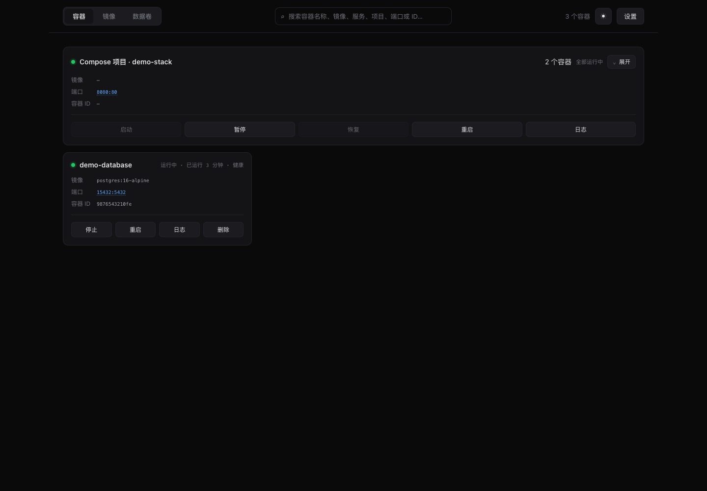
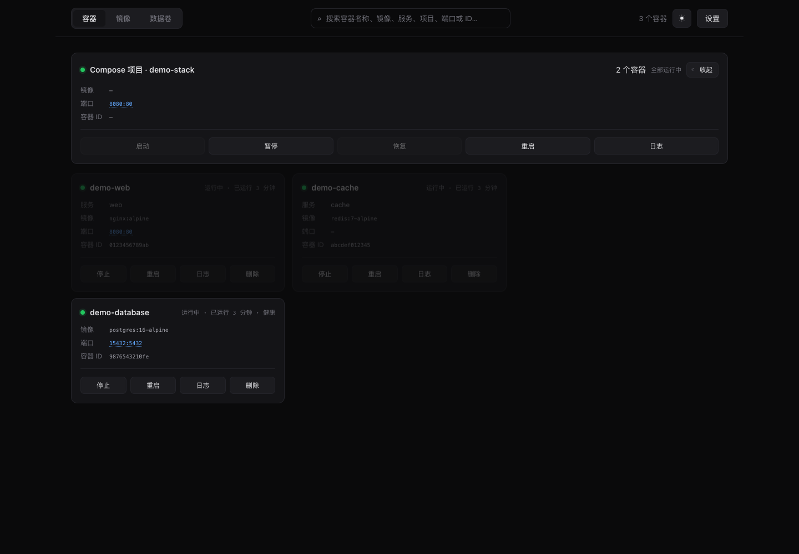
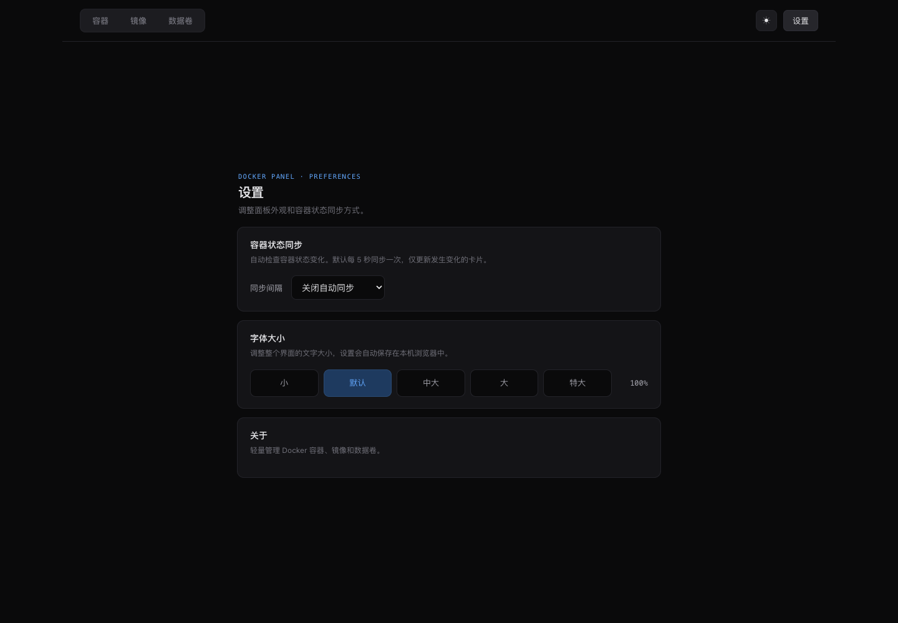

# docker-web

极简 Docker 管理面板，支持容器、Compose 项目、镜像和数据卷管理，可打包为单个 Docker 容器运行。

Docker Hub 镜像：[`xiansen11/docker-web:2.1.0`](https://hub.docker.com/r/xiansen11/docker-web)，支持 `linux/amd64` 和 `linux/arm64`。

- 前端：单个 `index.html`，零依赖、零构建
- 后端：`Bun.serve` 静态托管 + 反向代理到 `docker.sock`
- 镜像：`oven/bun:1-alpine`，最终约 **40 MB**

## 快速开始

```bash
# 本地运行（需要 bun）
bun run src/server.ts          # 默认 9999 端口
bun run src/server.ts 8080     # 指定端口

# Docker
docker compose up -d --build   # 或 docker build -t docker-panel .
docker run -d --name docker-panel -p 9999:9999 \
  -v /var/run/docker.sock:/var/run/docker.sock docker-panel

# 使用 Docker Hub 发布的镜像
docker run -d --name docker-panel --restart unless-stopped \
  -p 9999:9999 -v /var/run/docker.sock:/var/run/docker.sock \
  xiansen11/docker-web:2.1.0
```

打开 http://localhost:9999

## API

面板自身只暴露两个路径：

| 路径 | 说明 |
| --- | --- |
| `GET /` | 返回 `index.html` |
| `GET /healthz` | 健康检查：`{ ok, socket, uptime }`，Dockerfile `HEALTHCHECK` 使用 |

其余全部请求按 Docker Engine API 原样转发，例如 `GET /api/containers/json` → `GET /containers/json`（请求体、Content-Type、查询参数透传，chunked 响应自动解码）。

## Docker 部署要点

镜像内以非 root 用户 `bun` 运行，访问 `docker.sock` 靠 group 权限：

- `docker compose` 中已设 `user: "0:0"` 直接以 root 运行，最省事；
- 若想以非 root 运行，把 `user` 改为 `"1000:0"` 或宿主机 `docker` 组的实际 gid（`stat -f %g /var/run/docker.sock`）；
- 数据卷挂载 `/var/run/docker.sock` 后，容器内可管理**宿主机**的 Docker；若要管理 Docker-in-Docker，需另挂 `docker` 套接字或配合 `docker:dind` sidecar。
- 面板默认只监听 `127.0.0.1`。容器内该地址仅在容器自身回环可用，需在 `docker run` 时用 `-p 9999:9999` 发布端口才能从外部访问。

### Windows

当前镜像基于 Linux。Windows 请使用 Docker Desktop 的 Linux 容器模式和 WSL 2 后端，并在启用 Docker Desktop 集成的 WSL 发行版中运行 Compose。端口映射仍是 `9999:9999`；`/var/run/docker.sock` 是 Linux Docker socket，不能直接替换成 Windows named pipe。Docker Desktop 的 Windows + WSL 2 环境提供 Unix socket，供 Linux 容器访问 Docker Engine。

前端交互包括主题切换、搜索容器 / 镜像 / 数据卷、输入名称确认删除和日志查看。Compose 项目支持分组管理和项目日志，容器页后台静默同步状态，默认每 5 秒一次；同步间隔可在设置页更改或关闭，并保存在当前浏览器。右上角按钮打开设置；镜像和数据卷在打开页面、切换分类或执行操作后更新。

## 界面截图

以下截图使用虚构的演示容器数据，不包含本机容器信息。







## 文件结构

```
docker-web/
├── src/
│   ├── server.ts     # Bun 后端（服务 + 反向代理）
│   └── index.html    # 前端页面
├── Dockerfile
├── docker-compose.yml
├── package.json
```
